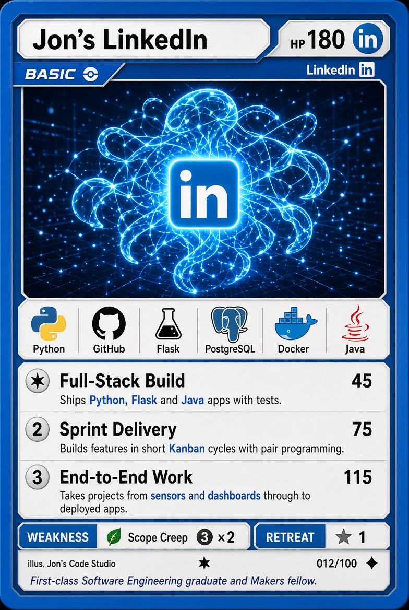
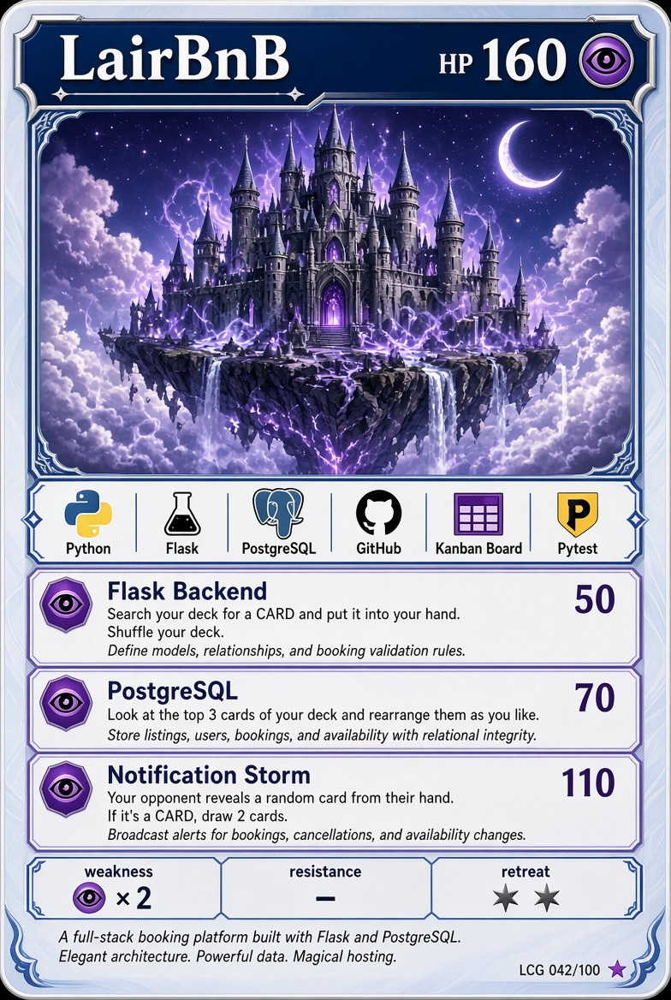

### Software Engineer | Python · Java · Kotlin

First-class Software Engineering graduate (Bournemouth University) currently in the trenches at the Makers full-stack bootcamp and am currently seeking **Graduate Software Engineering roles**

These days I spend my time writing Python and Java, building full-stack apps with Flask and PostgreSQL, and writing clean, test-driven code that won't make future-me cry.

---
### 🚀 About Me
- 🎓 **Education:** BSc (Hons) Software Engineering (First-Class Honours) — Bournemouth University  
  Makers Academy full-stack bootcamp & Java specialism
- 🔭 **Open to:** Graduate and junior software engineering opportunities
- 💻 **Focus:** Full-stack web applications, Test-Driven Development, and clean, maintainable code
- 🛠️ **Stack I use:** Python, Flask, PostgreSQL, Java, Kotlin, HTML/CSS, Git, Docker
- 🌱 **Always learning:** Expanding my toolkit across modern web development, cloud technologies, and software architecture
- 🍳 **Outside of code:** Half-Japanese home cook. Hosted bao pop-up evenings featuring slow-braised glazed pork belly bao buns, and brunch clubs serving chicken and waffles.

---
### 🃏 Links - *Click a Card, Any Card.* (Linkedin and Project Repos)
   

---

### 💻 Tech Stack & Tools

---

